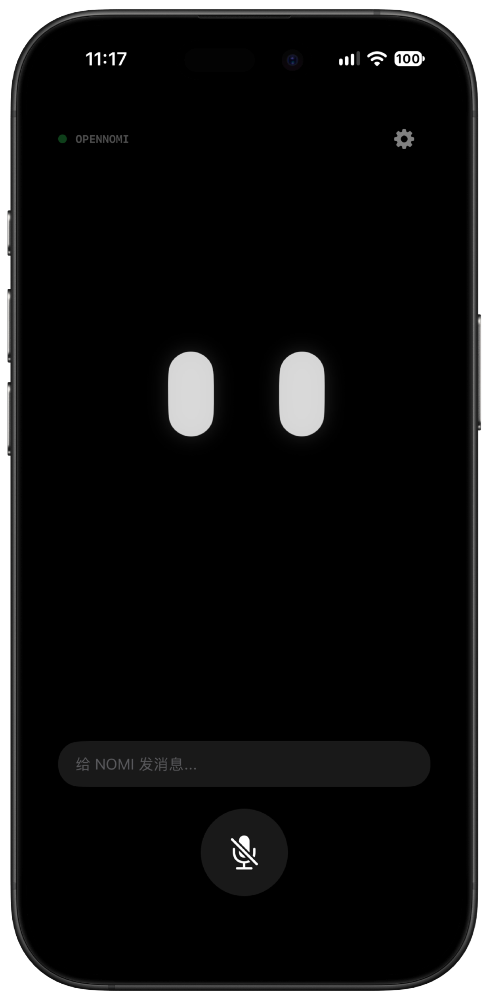
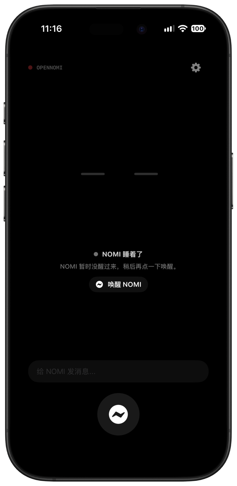
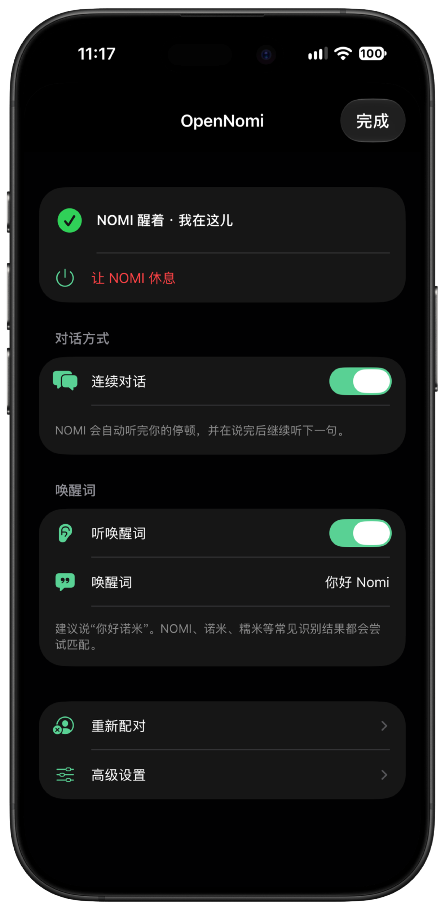

# OpenNomi

OpenNomi 是一个面向 iPhone 的开源 AI 陪伴客户端。它以 NOMI 的眼睛和表情为核心，通过语音、文字、姿态视差、触觉反馈和自然的休眠动画，让对话不只停留在聊天框里。

项目使用 SwiftUI 构建，通过小智协议连接兼容服务。

## 界面预览

<p align="center">
  
  
  
</p>

## 功能

- 语音对话、文字对话和可选的连续对话
- 自动识别说完、可自定义唤醒词
- 基于会话状态和服务端情绪的表情动画
- 眨眼、视差、触觉反馈与自然睡眠过渡
- 半自动设备绑定、验证码引导和自定义服务入口
- 深色与浅色界面适配

## 环境要求

- macOS 与 Xcode 26 或更高版本
- iOS 26 或更高版本
- Apple Developer 账号（真机调试和 TestFlight 发布需要）

## 开始使用

1. 克隆仓库并用 Xcode 打开 `OpenNomi.xcodeproj`。
2. 在 iOS target 的 Signing & Capabilities 中选择自己的开发团队，并按需修改 Bundle Identifier。
3. 选择 iPhone 模拟器或真机后运行 `OpenNomi` scheme。
4. 在 App 设置中确认服务地址。默认使用官方小智服务，也可以改为兼容的小智 WebSocket 服务。
5. 首次连接时，按照 App 内的提示前往服务端页面输入验证码完成绑定。

语音识别与录音需要麦克风和语音识别权限。

## 项目结构

```text
OpenNomi/             iOS App、对话状态、音频和表情
OpenNomi.xcodeproj/   Xcode 工程和共享 scheme
```

主要模块：

- `NomiExpressionView.swift`：主界面、表情与生命力动画
- `XiaozhiViewModel.swift`：连接、对话和 UI 状态管理
- `XiaozhiAudioManager.swift`：录音、Opus 编解码与播放
- `XiaozhiWebSocketClient.swift`：小智 WebSocket 协议

## 服务与隐私

OpenNomi 本身不提供 AI 服务。默认服务地址和绑定页面属于其各自服务提供方，使用时请遵守对应条款和隐私政策。语音、文字及设备信息可能会发送到你在 App 中配置的服务端，请只连接你信任的服务。

请不要在 issue、日志或提交中公开访问令牌、验证码、设备标识或包含私人对话的调试信息。发现安全问题请参阅 [SECURITY.md](SECURITY.md)。

## 参与贡献

欢迎提交 issue 和 pull request。开始前请阅读 [CONTRIBUTING.md](CONTRIBUTING.md)。

## 许可证

本项目基于 [MIT License](LICENSE) 开源。
